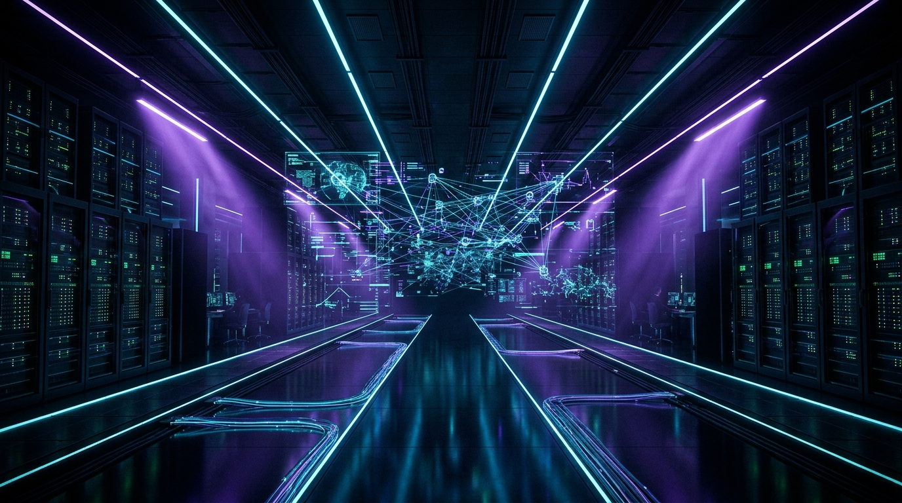
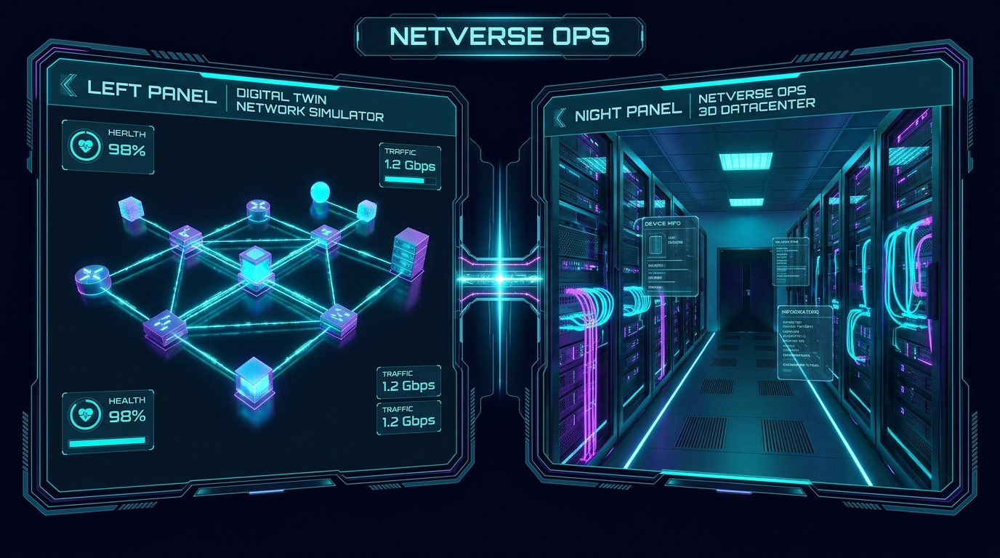
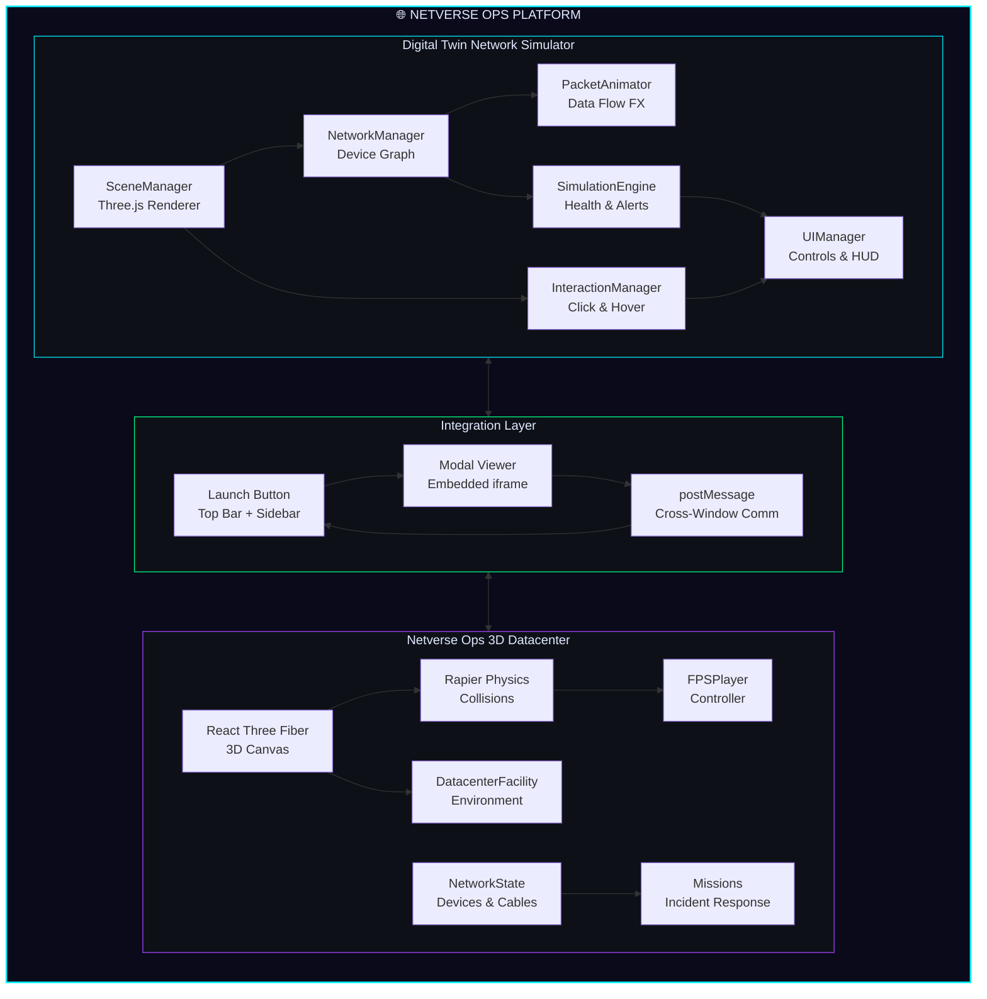
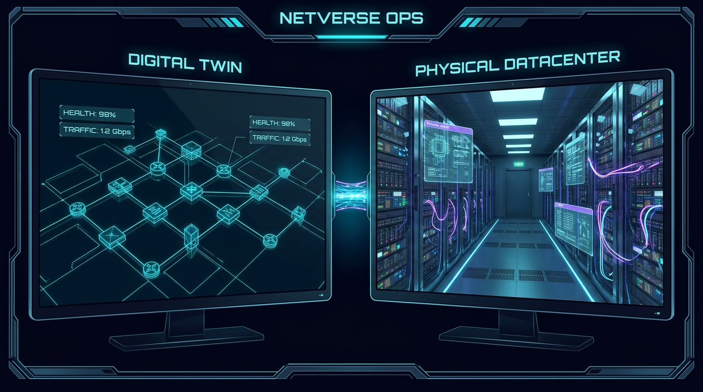

<div align="center">

<!-- HERO BANNER -->


<br/>

# ⚡ N E T V E R S E &nbsp; O P S

### *The Cyber-Physical Datacenter Simulation Platform*

<br/>

[](https://threejs.org)
[](https://react.dev)
[](https://www.typescriptlang.org)
[](https://vite.dev)
[](https://tailwindcss.com)
[](https://rapier.rs)

<br/>

<p align="center">
  <strong>Walk through a photorealistic 3D datacenter. Patch physical cables. Monitor live network topology.</strong>
  <br/>
  <strong>All in your browser. Zero installs. One platform.</strong>
</p>

<br/>

<a href="#-quick-start"></a>
&nbsp;&nbsp;
<a href="#-feature-highlights"></a>
&nbsp;&nbsp;
<a href="#-architecture"></a>

<br/><br/>

---

</div>

<br/>

## 🌐 What Is This?

**Netverse Ops** is a unified cyber-physical simulation platform that combines two powerful experiences:

| Module | Description |
|:------:|:------------|
| 🖥️ **Digital Twin Network** | A real-time 3D network topology simulator built with vanilla Three.js — visualize enterprise networks, data centers, IoT meshes, and home networks with live packet animation, device telemetry, and health monitoring |
| 🏗️ **Netverse Ops 3D** | A first-person 3D datacenter facility built with React Three Fiber + Rapier Physics — walk through server rooms, physically patch cables, run ICMP diagnostics, and resolve network incidents in a cinematic cyberpunk environment |

Both systems are **fully integrated** — switch between high-level network topology and physical datacenter walkthrough with a single click.

<br/>

<div align="center">

<br/>
<sub><i>Left: Digital Twin Network Topology Simulator &nbsp; ⚡ &nbsp; Right: Netverse Ops 3D Datacenter Facility</i></sub>
</div>

<br/>

---

<br/>

## ✨ Feature Highlights

<table>
<tr>
<td width="50%" valign="top">

### 🌐 Digital Twin Network Simulator

- **5 Network Topologies** — Enterprise, Data Center, Home, IoT, Mesh
- **Real-Time Packet Animation** — Watch data flow across your network
- **8 Device Types** — Routers, Switches, Servers, Firewalls, Workstations, Cloud, Database, Load Balancers
- **Live Telemetry** — CPU, Memory, Bandwidth, Latency per device
- **Device Interaction** — Click any node to inspect, toggle status, or remove
- **Network Health Scoring** — Global health bar with smart alert system
- **Simulation Speed Control** — Pause, slow-mo, or accelerate time
- **Dynamic Alerts** — Real-time warning and critical alert feed

</td>
<td width="50%" valign="top">

### 🏗️ Netverse Ops 3D Datacenter

- **First-Person Exploration** — WASD + mouse look with sprint & jump
- **Physical Cable Patching** — Plug/unplug Ethernet & fiber cables on server racks
- **ICMP Ping Diagnostics** — Run real graph-traversal pings with TTL, latency, and packet loss
- **4 Critical Missions** — Incident response: reboot, reconnect, QoS optimize, thermal cycle
- **Day/Night Toggle** — Switch between cyberpunk night mode and golden morning sunlight
- **Live Network Health HUD** — Real-time health, device count, traffic metrics
- **Topology Overlay** — Press TAB for a holographic network map
- **Touch Controls** — Full mobile support with virtual joystick & buttons

</td>
</tr>
</table>

<br/>

### 🔌 Integration Features

<div align="center">

```
┌─────────────────────────────────────────────────────────────────┐
│                    NETVERSE OPS PLATFORM                        │
│                                                                 │
│  ┌──────────────────┐    ⚡ ONE CLICK    ┌──────────────────┐  │
│  │   DIGITAL TWIN   │ ◄═══════════════► │  NETVERSE OPS 3D │  │
│  │   NETWORK SIM    │    INTEGRATION     │  DATACENTER      │  │
│  │                  │                    │                  │  │
│  │  • Topology View │                    │  • FPS Walkthru  │  │
│  │  • Packet Flow   │                    │  • Cable Patch   │  │
│  │  • Device Mgmt   │                    │  • ICMP Diag     │  │
│  │  • Alert System  │                    │  • Missions      │  │
│  └──────────────────┘                    └──────────────────┘  │
│                                                                 │
│  [⚡ Top Bar Launch]  [📋 Sidebar Launch]  [↗ New Tab]         │
│  [⛶ Fullscreen]      [✕ Close / ESC]     [🔄 Switch Back]    │
└─────────────────────────────────────────────────────────────────┘
```

</div>

<br/>

---

<br/>

## 📐 Architecture



<br/>

### 📁 Project Structure

```
netverse-ops/
├── 📁 digital-twin-network/          # 3D Network Topology Simulator
│   ├── 📁 css/
│   │   └── styles.css                # Cyberpunk glassmorphism UI
│   ├── 📁 js/
│   │   ├── main.js                   # App entry & animation loop
│   │   ├── SceneManager.js           # Three.js scene, camera, renderer
│   │   ├── NetworkManager.js         # Device graph & topology engine
│   │   ├── PacketAnimator.js         # Animated data packet flows
│   │   ├── SimulationEngine.js       # Health simulation & alert gen
│   │   ├── InteractionManager.js     # Raycasting & device selection
│   │   └── UIManager.js              # HUD, sidebar, modals, integration
│   ├── 📁 netverse/                  # Built Netverse Ops (production)
│   │   ├── index.html
│   │   └── 📁 assets/               # Compiled JS + CSS bundles
│   └── index.html                    # Main entry point
│
├── 📁 netverse-ops/                  # 3D Datacenter Facility (source)
│   ├── App.tsx                       # Main app — HUD, missions, state
│   ├── Game.tsx                      # R3F Canvas, physics, lighting
│   ├── 📁 components/
│   │   ├── DatacenterFacility.tsx    # Server rooms, racks, cables
│   │   ├── FPSPlayer.tsx            # First-person controller
│   │   ├── HumanoidCharacter.tsx    # NPC characters
│   │   └── AnimalCharacter.tsx      # Environment creatures
│   ├── 📁 utils/
│   │   ├── helper.tsx               # UI overlays, audio, mobile
│   │   ├── BackgroundMusic.tsx      # Adaptive audio system
│   │   ├── usePlayground.ts         # SDK integration hooks
│   │   └── playground-fake.ts       # Local dev multiplayer stub
│   ├── networkState.ts              # 15+ network devices & cabling
│   ├── types.ts                     # TypeScript interfaces
│   ├── constants.ts                 # Game configuration
│   └── input.ts                     # Keyboard/mouse/touch input
│
├── 📁 assets/                        # README images & media
├── server.mjs                        # Zero-dep static file server
├── test_integration.mjs              # Automated integration tests
├── package.json                      # Root project scripts
└── README.md                         # ← You are here
```

<br/>

---

<br/>

## 🚀 Quick Start

### Prerequisites

- **Node.js** 18+ and **npm** 9+
- Any modern browser (Chrome, Firefox, Edge, Safari)

### 1. Clone & Enter

```bash
git clone https://github.com/harishyuvaraj641-pixel/NETVERSE-OPS.git
cd NETVERSE-OPS
```

### 2. Launch (Zero Build Required!)

The Digital Twin Network runs as static HTML — no build step needed:

```bash
# Option A: Node.js static server (included)
node server.mjs
# → Opens at http://localhost:8000

# Option B: Python
python -m http.server 8000 --directory digital-twin-network

# Option C: npx
npx serve digital-twin-network
```

### 3. Open & Explore

1. Navigate to **http://localhost:8000**
2. The Digital Twin Network loads with an Enterprise topology
3. Click the **⚡ Netverse Ops** button (top-right) to enter the 3D datacenter
4. Click **START SIMULATION** and explore!

<br/>

### 🛠️ Development Mode (Netverse Ops)

To develop the 3D datacenter with hot-reload:

```bash
cd netverse-ops
npm install
npm run dev
# → Opens at http://localhost:3000 with HMR
```

To rebuild production assets:

```bash
cd netverse-ops
npm run build
# Copy dist/ → digital-twin-network/netverse/
```

<br/>

---

<br/>

## 🎮 Controls

<div align="center">

### ⌨️ Keyboard & Mouse

| Key | Action |
|:---:|:-------|
| `W` `A` `S` `D` | Move forward, left, backward, right |
| `Mouse` | Look around (first-person camera) |
| `Shift` | Sprint |
| `Space` | Jump |
| `E` | Interact — Patch cables, inspect devices |
| `TAB` | Toggle network topology overlay |
| `ESC` | Pause / Close menus |

### 📱 Touch Controls

| Input | Action |
|:-----:|:-------|
| Left Stick | Movement |
| Right Area Drag | Camera look |
| Sprint Button | Run |
| Jump Button | Jump |
| Interact Button | Patch cables / Inspect |

</div>

<br/>

---

<br/>

## 🔧 Tech Stack

<div align="center">

| Layer | Technology | Purpose |
|:-----:|:-----------|:--------|
| 🎨 **3D Rendering** | Three.js r160 | WebGL scene graph, materials, lighting |
| ⚛️ **UI Framework** | React 18 + R3F | Declarative 3D components |
| 🧊 **Physics** | Rapier (WASM) | Rigid body collisions, character controller |
| ✨ **Post-Processing** | pmndrs/postprocessing | Bloom, tone mapping, effects |
| 🎨 **Styling** | Tailwind CSS 3 | Utility-first responsive UI |
| 📦 **Bundler** | Vite 6 | Sub-second HMR, optimized builds |
| 📘 **Language** | TypeScript 5 | Full type safety |
| 🎵 **Audio** | Web Audio API | Adaptive background music & SFX |
| 🖼️ **Icons** | Lucide React | Crisp SVG icon library |

</div>

<br/>

---

<br/>

## 🌟 Roadmap

- [ ] 🌍 **Multiplayer Mode** — Collaborative datacenter ops with WebSocket sync
- [ ] 📊 **Real Data Integration** — Connect to SNMP/NetFlow for live device feeds
- [ ] 🤖 **AI Anomaly Detection** — ML-powered predictive failure alerts
- [ ] 🔥 **Disaster Scenarios** — Fire, power outage, and DDoS attack simulations
- [ ] 🗺️ **Multi-Floor Facilities** — Elevator navigation between datacenter levels
- [ ] 📱 **PWA Support** — Install as a native app on mobile/desktop
- [ ] 🎓 **Training Mode** — Guided tutorials for networking students
- [ ] 🔌 **Plugin System** — Custom device types and topology importers

<br/>

---

<br/>

## 🤝 Contributing

Contributions are welcome! Here's how:

1. **Fork** the repository
2. **Create** your feature branch (`git checkout -b feature/amazing-feature`)
3. **Commit** your changes (`git commit -m 'Add amazing feature'`)
4. **Push** to the branch (`git push origin feature/amazing-feature`)
5. **Open** a Pull Request

<br/>

---

<br/>

## 📜 License

This project is available for educational and personal use.

See [THIRD_PARTY_NOTICES.md](netverse-ops/THIRD_PARTY_NOTICES.md) for open-source dependency licenses.

<br/>

---

<br/>

<div align="center">



<br/><br/>

### Built by [Harish Yuvaraj](https://github.com/harishyuvaraj641-pixel)

<br/>

**If you found this project cool, drop a ⭐ — it means a lot!**

<br/>

<a href="https://github.com/harishyuvaraj641-pixel/NETVERSE-OPS">
  
</a>
&nbsp;
<a href="https://github.com/harishyuvaraj641-pixel/NETVERSE-OPS/fork">
  
</a>
&nbsp;
<a href="https://github.com/harishyuvaraj641-pixel/NETVERSE-OPS/issues">
  
</a>

</div>

<br/>
